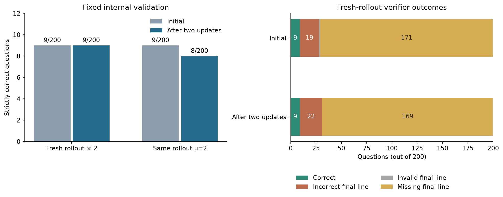

# M0 最终报告：GRPO 训练闭环可复现，内部验证未见准确率提升

## 结论

- 在 Apple Silicon MPS 上，项目完成了单轮 GSM8K 的采样、确定性奖励、组内优势、response-masked clipped GRPO loss、参数更新及独立评估。两种训练安排均实际完成两次全参数更新。
- 两轮**新采样、各更新一次**的模型在固定内部验证集上为 **9/200 → 9/200（4.5% → 4.5%）**；同一组 rollout **连续更新两次**为 **9/200 → 8/200（4.5% → 4.0%）**。这些记录证明训练路径运行，但没有观察到 held-out 准确率收益。
- 报告预先选择前一种训练安排的最终 `step-000002` checkpoint 进行唯一一次官方 test 评估，因为它在同一内部验证集上是两个已训练候选中较高的一个。**官方 test 严格正确 40/1,319（3.03%）**；test 未用于候选选择，也没有评估初始模型，因此不能从这个数字推断 test 上的训练增益。



图 1：左图的每根柱子分母均为同一批 200 道内部验证题；右图只展示两轮新采样实验的初始与最终严格 verifier 分类。图由两份运行汇总生成，脚本见 [`plot_m0_results.py`](../scripts/plot_m0_results.py)。

## 实验契约

| 项目 | 固定设置 |
|---|---|
| 任务与数据 | `openai/gsm8k` 的 `main` 配置，revision `740312add88f781978c0658806c59bc2815b9866`。原始 train 共 7,473 题，以 seed 42 的 SHA-256 排名选 200 题作内部验证，其余 7,273 题供训练。官方 test 为独立的 1,319 题。 |
| 模型 | `Qwen/Qwen2.5-0.5B-Instruct`，模型与 tokenizer revision 均为 `7ae557604adf67be50417f59c2c2f167def9a775`；float32、全参数 AdamW、Apple Silicon MPS。 |
| 训练采样 | 每道题 `G=4`；temperature `1.0`、top-p `1.0`、top-k `0`，最多 256 个新 token。仅在训练分区按题目长度优先查找有混合奖励的组。 |
| 奖励与优化 | 仅接受最后一行完整的 `#### <number>` 并与参考答案作精确数值比较；正确为 1，其余为 0。组内 population 标准差归一化优势；`clip_epsilon=0.2`、`beta=0`、学习率 `1e-7`、梯度范数上限 `1.0`。loss 只覆盖有效生成 token，包括实际生成的 EOS。 |
| 评估 | 固定 chat template 与严格 verifier；greedy 解码、最多 128 个新 token。初始和最终模型在**同一**内部验证集上比较；官方 test 仅评估预先选定的训练后模型。 |

训练配置见 [`m0-run.yaml`](../configs/m0-run.yaml) 与 [`m0-mu2.yaml`](../configs/m0-mu2.yaml)；数据边界见 [`grpo-dataflow.md`](grpo-dataflow.md)。`pass@1` 在本报告中指一次 greedy 生成后通过上述严格 verifier 的题数除以题数，不等同于人工判定的数学正确率。

## 训练与内部验证结果

| 训练安排 | 训练题组 | 两次更新后的 `approx_kl_old` | 初始严格正确 | 最终严格正确 | 配对变化 |
|---|---|---:|---:|---:|---|
| 两轮新采样，各更新一次 | `train/01214`、`train/01809` | `0.00393`、`0.00101` | 9/200 | 9/200 | 2 题变对、2 题变错；54 条回答文本改变 |
| 同一组采样，连续更新两次 | 两次均为 `train/01214` | `0.00393`、`0.01062` | 9/200 | 8/200 | 1 题变对、2 题变错；58 条回答文本改变 |

两轮新采样的每次选中组均为 `[0, 0, 1, 0]`，但各自扫描的 7 组中有 6 组奖励全相同；这说明在该模型、提示词和采样设置下，找到 GRPO 可用组并不容易。选中组的奖励率是经过筛选的训练诊断，不能代替 held-out 表现。证据分别在 [新采样运行汇总](../results/m0/end-to-end-v2/summary.json)、[同批两次更新汇总](../results/m0/end-to-end-mu2-v1/summary.json) 和各自的 `steps/` 目录。

在同批两次更新中，第二次更新前的最大 ratio 偏差为 `0.534`，clip fraction 为 `0.0355`；第二次更新后 clip fraction 为 `0.0851`。这是更新后的模型继续对**同一份旧策略概率**优化的直接记录。两个安排只跑了各自这一条短轨迹，9/200 与 8/200 的差异不能支持哪种安排普遍更优。

## 官方 test：预先选定的训练后模型

选定模型在官方 test 上严格正确 **40/1,319（3.03%）**。逐题记录共 1,319 行，按同一严格 verifier 复核得到如下互斥分类：

| 严格 verifier 结果 | 题数 | 占官方 test 比例 |
|---|---:|---:|
| 正确的最终数字 | 40 | 3.03% |
| 有效格式、数字错误 | 114 | 8.64% |
| 最终行数字格式无效 | 7 | 0.53% |
| 缺少最终答案行 | 1,158 | 87.79% |

另有 **412/1,319** 条达到 128-token 上限，其中 407 条同时缺少最终行；**751 条**在正常 EOS 结束后仍缺少最终行。平均生成长度约 72.27 token。长度截断与 verifier 分类不能相加，也不能把缺少最终行直接解释为数学能力错误。[汇总](../results/m0/official-test-v1/summary.json)、[逐题记录](../results/m0/official-test-v1/test-rows.jsonl)和[运行清单](../results/m0/official-test-v1/manifest.json)构成这一分数的原始证据。

这是一份**训练后模型的单次 test 绝对结果**：本报告没有在官方 test 上运行初始模型，因而没有 test 级别的训练前后差值。内部验证的 9/200 和官方 test 的 40/1,319 来自不同题集，也不能相减作为训练效果。test 结果出炉后未调整模型、提示词或 verifier。

官方 test 使用独立的 `main/test-00000-of-00001.parquet`，固定 revision 与原始文件 SHA-256 `ee7b8da9e381df27b9e3f7758a159ab2bdaa4dbaa910546cbbc47e0cb44e4f59`。评估入口先校验源运行的配置哈希和最终 checkpoint 的公开校验清单，再加载原始 pinned tokenizer 与训练后的模型；答案仅由 verifier 使用，不进入模型 prompt。[评估规格](../configs/m0-final-test.yaml)与[评估代码](../scripts/evaluate_official_test.py)固定了该路径。

## 失败分析与解释边界

两轮新采样模型的内部验证中，最终 **169/200** 条回答缺少要求的最后一行，另有 22 条给出格式有效但数值错误的答案，9 条严格正确；75 条达到 128-token 上限。`missing_final_answer` 与长度截断是两个可重叠维度，不能直接相加。逐题原始记录见[初始](../results/m0/end-to-end-v2/validation-initial.jsonl)和[最终](../results/m0/end-to-end-v2/validation-final.jsonl)。

其中 94 条在正常 EOS 结束后仍缺少最终行，75 条在长度上限处缺少最终行。一个具体例子是 `gsm8k/main/train/01646`：初始回答已在正文算出 110，却没有要求的最终行；更新后以 `#### 110` 结束，严格奖励才从 0 变为 1。此例说明格式会影响指标，但不能据此推断所有缺失最终行的回答都算对了。

为了区分长度限制与格式失败，另用训练分区中未在该两次更新里扫描的 100 题，对最终模型作只读诊断：128-token 限制下 6 题严格正确、83 题缺少最终答案行、33 题截断；仅把这 33 题的上限提高到 256 后，**没有一题新变为严格正确**，其中 18 题仍截断。[诊断汇总](../results/m0/failure-diagnostic-v1/summary.json)与[设计说明](m0-failure-diagnostic-v1.md)保留每题证据。这 100 题来自训练分区，不能作为新的 held-out 准确率；缺少 `####` 的回答也可能在正文中包含正确或错误的数值，所以不能把 83 题都归因为纯格式问题。

## 复现与限制

环境记录为 Apple M5 Pro、64 GB 统一内存、Python 3.12、PyTorch 2.14.0、Transformers 4.57.6。公开仓库保留配置、逐题 JSONL、step 指标、测试和 checkpoint 的 SHA-256；模型权重约每份 1.9 GB，按既定选择只保留在本地。**精确复核本报告所用 checkpoint 需要该本地权重**；公开读者可以从头重跑同一流程并比较结果，但新 MPS 运行的权重未必字节一致。checkpoint 未保存 AdamW 状态，也不能保证中途续训语义。用新 checkpoint 做官方 test 时须记录新的路径与校验值，不能把它冒充为本报告的原始运行。

```bash
uv sync
.venv/bin/python -m unittest discover -s tests -q
HF_HUB_OFFLINE=1 .venv/bin/python -m scripts.run_m0 \
  --config configs/m0-run.yaml --output-dir results/m0/my-new-run
shasum -a 256 -c results/m0/end-to-end-v2/checkpoint-sha256.txt
```

运行已报告的官方 test 还需要保留已选定的本地 checkpoint，并先把固定 revision 的 test parquet 缓存到本机。以下命令明确禁用过期隐式凭据、下载**公开且固定版本**的文件，然后在新目录运行只读评估；脚本会校验文件与 checkpoint 哈希：

```bash
HF_HUB_DISABLE_IMPLICIT_TOKEN=1 .venv/bin/python - <<'PY'
from huggingface_hub import hf_hub_download
hf_hub_download(
    repo_id="openai/gsm8k", repo_type="dataset",
    filename="main/test-00000-of-00001.parquet",
    revision="740312add88f781978c0658806c59bc2815b9866",
    token=False,
)
PY
HF_HUB_OFFLINE=1 .venv/bin/python -m scripts.evaluate_official_test \
  --spec configs/m0-final-test.yaml --output-dir results/m0/my-official-test
```

图 1 可从公开汇总重画：`uv run --with matplotlib python -m scripts.plot_m0_results`。本次官方 test 的 1,319 条逐题记录已与固定 test 文件逐题对齐，并重新用严格 verifier 检查了奖励、正确数、失败类别和平均 token 长度；复核不重新生成模型回答。

本实验只做了两个参数更新，训练时通过混合奖励筛选题组；它没有证明数学推理能力提升，也没有覆盖多步工具调用、分布式 rollout 或生产训练稳定性。训练和评估的精确耗时、生成吞吐、峰值统一内存未在原始运行中可靠记录，本报告不据此作性能声称。下一阶段如果比较 vLLM/SGLang 后端，需要先固定同样的采样、权重版本和 reward 口径，并单独测量吞吐与同步误差。

因此，M0 可以作为“自己实现并验证可复现的单轮 GRPO 训练与评估闭环，并如实分析负结果”的求职案例；不能写成“GRPO 提升了 GSM8K 准确率”。原计划的定量吞吐与峰值内存记录仍是未完成的性能证据，若将来要主张系统性能，需另做受控测量。
